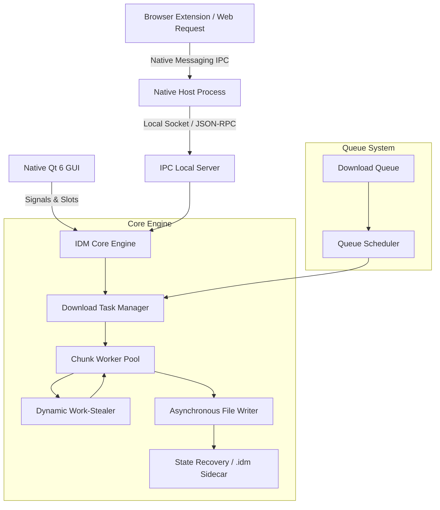

# Internet Download Manager (IDM) Native Accelerator

<div align="center">


<br/>

[](https://github.com/Someshwar-Sahu/idm/actions/workflows/build_all_platforms.yml)
[](https://isocpp.org/)
[](https://www.qt.io/)
[](https://github.com/Someshwar-Sahu/idm/actions)
[](LICENSE)

**A high-performance, multithreaded download accelerator engineered in modern C++ with a pure native Qt 6 desktop interface.**  
Features intelligent dynamic work-stealing, resilient pause/resume integrity, automated queue scheduling, and seamless browser integration.

[Download Installers](#-download-installers) • [Key Features](#-key-features) • [Architecture](#-architecture--engine-internals) • [Building From Source](#-building-from-source)

</div>

---

## 📦 Download Installers

Automated multi-platform binaries are compiled directly from source for each operating system:

| Platform | Package Format | Target Architecture | Description | Quick Download |
| :--- | :---: | :---: | :--- | :---: |
| 🪟 **Windows** | **`.exe`** | `x86_64` (64-bit) | Standalone Inno Setup installer with Desktop shortcuts, Start Menu entry, registry setup, and pure GUI (no console window). | [**Download .exe**](https://github.com/Someshwar-Sahu/idm/actions) |
| 🍏 **macOS** | **`.dmg`** | `arm64` / `x86_64` | Native Apple Disk Image with drag-and-drop `IDMan.app` bundle and Cocoa integration. | [**Download .dmg**](https://github.com/Someshwar-Sahu/idm/actions) |
| 🐧 **Linux** | **`.deb`** | `x86_64` (Ubuntu / Debian) | Native Debian package for Ubuntu, Linux Mint, Debian, and Pop!_OS via `apt` or `dpkg`. | [**Download .deb**](https://github.com/Someshwar-Sahu/idm/actions) |
| 🐧 **Linux** | **`.tar.gz`** | `x86_64` (Universal) | Portable standalone tarball archive with pre-linked dependencies. | [**Download .tar.gz**](https://github.com/Someshwar-Sahu/idm/actions) |

> **Tip:** You can always find the latest pre-built `.dmg`, `.deb`, and `.exe` packages under the **Artifacts** section of the latest [GitHub Actions Build](https://github.com/Someshwar-Sahu/idm/actions).

---

## ⚡ Key Features

### 🚀 Dynamic Chunk Work-Stealing
- Divides any file into multiple concurrent segments (configurable up to 32 streams).
- Fast worker threads that finish early automatically **steal and bisect remaining slow chunks** in real-time, preventing stalled segments and saturating your connection bandwidth.

### 🛡️ Resilient Pause, Resume & State Recovery
- Non-destructive sidecar state persistence (`.idm` metadata files).
- Downloads survive network interruptions, computer restarts, and server-side socket resets without file corruption or byte loss.

### 🗂️ Category Partitioning & File Sorting
- Automatically organizes incoming downloads into dedicated category directories:
  - 📄 **Documents** (`.pdf`, `.docx`, `.xlsx`, `.txt`, etc.)
  - 📦 **Compressed** (`.zip`, `.rar`, `.7z`, `.tar`, `.gz`, `.iso`, etc.)
  - 🎬 **Video** (`.mp4`, `.mkv`, `.avi`, `.mov`, `.webm`, etc.)
  - 🎵 **Music** (`.mp3`, `.flac`, `.wav`, `.aac`, etc.)
  - 💻 **Programs** (`.exe`, `.msi`, `.dmg`, `.deb`, `.pkg`, etc.)
  - 📁 **General** (all other file formats)

### ⏱️ Scheduler & Queue Automation
- Advanced FIFO queue processor with configurable concurrent task limits.
- Schedule automatic download start and stop times, recurring downloads, and post-queue triggers (e.g., *Turn off computer when done*, *Sleep*, *Close connection*).
- Filtering proxy models hide completed/cancelled tasks from active queue views.

### 🌐 Seamless Browser Integration (Chrome, Edge, Firefox)
- Built-in **Native Messaging Host** (`com.idm.native_host`).
- Browser extension automatically captures downloads, media streams, and right-click download requests directly into IDM.
- Per-browser toggle and exception site list configuration.

### 🔐 Site Logins Vault
- Encrypted storage for protected servers requiring HTTP Basic, Digest, or Bearer authentication.

---

## 🛠️ Architecture & Engine Internals



---

## 💻 Building From Source

### Prerequisites
- **CMake** (>= 3.20)
- **Ninja** or **Make**
- **Qt 6.7+** (`Core`, `Gui`, `Widgets`, `Network`, `Svg`)
- **C++20 compliant compiler** (GCC 13+, Clang 15+, or MSVC 2022)
- **libcurl** (automatically fetched if not present on system)

### 1. Windows (MinGW 64-bit)

```powershell
# Configure CMake
cmake -B build -G "Ninja" -DCMAKE_BUILD_TYPE=Release -DCMAKE_PREFIX_PATH="C:\Qt\6.7.2\mingw_64"

# Build IDMan.exe
cmake --build build --target idm_app --config Release

# Package dependencies into dist/
.\package.ps1

# (Optional) Compile standalone setup executable
& "D:\Inno Setup 6\ISCC.exe" installer.iss
```

The resulting installer is generated at:  
`installer_output/IDMan_Setup_v6.42.exe`

### 2. Linux (Ubuntu / Debian)

```bash
# Install build dependencies
sudo apt-get update && sudo apt-get install -y \
  build-essential cmake ninja-build qt6-base-dev qt6-base-dev-tools \
  libqt6svg6-dev libgl1-mesa-dev libegl1-mesa-dev libxkbcommon-dev libcurl4-openssl-dev

# Build & Package .deb
./package_linux.sh
```

The native package is generated at:  
`build/idman-6.42.0-Linux.deb`

### 3. macOS (Apple Silicon & Intel)

```bash
# Make sure Qt 6 is installed (via Homebrew or official installer)
brew install qt@6 ninja

# Build & Package .dmg
./package_mac.sh
```

The standalone disk image is generated at:  
`build/IDMan_macOS_v6.42.dmg`

---

## 📂 Project Directory Structure

```
idm/
├── .github/
│   └── workflows/
│       └── build_all_platforms.yml # Multi-platform CI/CD (Win/Mac/Linux)
├── src/
│   ├── config/                     # SettingsManager & JSON persistence
│   ├── core/                       # DownloadTask, ChunkWorker, Work-stealing
│   ├── gui_qt/                     # Native Qt 6 Dialogs, Models & Views
│   ├── ipc/                        # Local IPC Socket Server
│   ├── native_host/                # Chrome/Edge Native Messaging Host
│   ├── net/                        # NetworkMonitor, PowerMonitor, QoS
│   ├── queue/                      # DownloadQueue & QueueScheduler
│   └── security/                   # Encrypted Credential Vault & Scanner
├── extension/                      # Chrome / Edge Browser Extension
├── installer.iss                   # Inno Setup Windows installer script
├── package.ps1                     # Windows Qt deployment script
├── package_linux.sh                # Linux CPack .deb packager
├── package_mac.sh                  # macOS macdeployqt .dmg packager
├── CMakeLists.txt                  # Universal CMake build definitions
└── README.md                       # Project documentation
```

---

## 📜 License

This project is licensed under the MIT License - see the [LICENSE](LICENSE) file for details.
All trademarks, logos, and brand names are the property of their respective owners.
