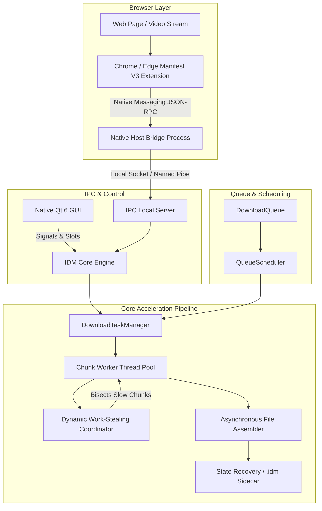

# Internet Download Manager (IDM) — Native C++ Accelerator

<div align="center">


[](https://github.com/Someshwar-Sahu/idm/actions/workflows/build_all_platforms.yml)
[](https://isocpp.org/)
[](https://www.qt.io/)
[](https://github.com/Someshwar-Sahu/idm/actions)
[](#-academic-disclaimer--license)

**A high-performance, multithreaded download accelerator developed in modern C++ with a pure native Qt 6 desktop interface.**  
*Engineered as an Academic Computer Science & Systems Programming Capstone Project.*

[Installers](#-pre-built-installers) • [Browser Extension Setup](#-browser-extension-setup) • [Features](#-key-features) • [Engine Architecture](#-engine-architecture--internals) • [Building From Source](#-building-from-source) • [Disclaimer](#-academic-disclaimer--license)

</div>

---

## 🎓 Academic Notice & Project Scope

> **Important Academic Disclaimer:**  
> This project is an **independent academic implementation** created solely for educational, research, and portfolio purposes for a college engineering degree.  
> - **Clean-Room Engineering:** All backend network routines, socket IPC, dynamic work-stealing algorithms, and Qt desktop interfaces were written from scratch. Zero proprietary or decompiled code is used.  
> - **Trademark Notice:** This project is **not affiliated with, endorsed by, or associated with Tonec Inc.** or the commercial software "Internet Download Manager". All visual styling and workflow patterns are implemented as an academic study in network protocol acceleration and desktop systems engineering.

---

## 📦 Pre-Built Installers

Native release packages are compiled across all three operating systems via GitHub Actions CI/CD:

| Operating System | Package | Architecture | Features | Download |
| :--- | :---: | :---: | :--- | :---: |
| 🪟 **Windows** | **`.exe`** | 64-bit (`x86_64`) | Standalone Inno Setup Wizard, Desktop & Start Menu shortcuts, native browser host registration, zero terminal popups. | [**Download .exe**](https://github.com/Someshwar-Sahu/idm/actions) |
| 🍏 **macOS** | **`.dmg`** | Apple Silicon & Intel | Native Apple Disk Image with drag-and-drop `IDMan.app` bundle and macOS menu integration. | [**Download .dmg**](https://github.com/Someshwar-Sahu/idm/actions) |
| 🐧 **Linux** | **`.deb`** | Ubuntu / Debian | Native `.deb` package installable via `sudo dpkg -i` on Ubuntu, Debian, Linux Mint, and Pop!_OS. | [**Download .deb**](https://github.com/Someshwar-Sahu/idm/actions) |
| 🐧 **Linux** | **`.tar.gz`** | Universal Linux | Portable tarball archive with pre-linked binaries for Arch, Fedora, openSUSE, etc. | [**Download .tar.gz**](https://github.com/Someshwar-Sahu/idm/actions) |

> 💡 **Where to download:** In the GitHub repository, navigate to the [**Actions**](https://github.com/Someshwar-Sahu/idm/actions) tab, open the latest workflow run, and scroll to the **Artifacts** table at the bottom of the page to download any package.

---

## 🧩 Browser Extension Setup (Chrome & Edge)

Because this is an independent academic project and not published on the commercial Google Chrome Web Store, the browser extension is loaded locally via **Developer Mode**:

```
idm/
└── extension/
    ├── manifest.json                  # Manifest V3 extension configuration
    ├── background.js                  # Background service worker & native bridge
    ├── content.js                     # Media stream & download link interceptor
    ├── com.idm.native_host.json       # Native Messaging Host manifest
    └── install_native_host.ps1        # Windows registry registration script
```

### Step 1: Load the Extension in Your Browser
1. Open **Google Chrome** or **Microsoft Edge**.
2. Navigate to your browser's extensions page:
   - Chrome: `chrome://extensions`
   - Edge: `edge://extensions`
3. Toggle on **Developer mode** (switch located in the top-right corner).
4. Click the **Load unpacked** button.
5. In the file picker, select the [`extension/`](extension/) directory from this repository.
6. The **IDM Download Integration** extension will appear with a 32-character Extension ID (e.g., `bjgkbgeokfiebnpmenpcojhlehlapjih`).

---

### Step 2: Register the Native Messaging Host

The Native Messaging Host is a lightweight C++ bridge that allows the browser extension to communicate directly with the local IDM desktop app via standard I/O (stdin/stdout).

#### On Windows:
1. Open **PowerShell as Administrator** in the project directory.
2. Run the registration script:
   ```powershell
   .\extension\install_native_host.ps1
   ```
   *(Note: If you install IDM using the pre-built `IDMan_Setup_v6.42.exe`, this registration happens automatically during setup).*

#### On Linux / macOS:
Copy the [`com.idm.native_host.json`](extension/com.idm.native_host.json) manifest to your browser's native messaging directory:
- **Linux (Chrome)**: `~/.config/google-chrome/NativeMessagingHosts/`
- **Linux (Chromium)**: `~/.config/chromium/NativeMessagingHosts/`
- **macOS (Chrome)**: `~/Library/Application Support/Google/Chrome/NativeMessagingHosts/`

Ensure the `"path"` in `com.idm.native_host.json` points to the compiled `IDMan` executable on your system.

---

## ⚡ Key Features

- **🚀 Dynamic Work-Stealing Chunking:**
  Files are divided into concurrent byte-range streams (configurable up to 32 connections). Faster worker threads that finish early dynamically bisect and assist slower connections, eliminating lagging tails and saturating available network bandwidth.

- **🛡️ State Recovery & Resilient Resume:**
  Non-destructive sidecar metadata (`.idm`) persists chunk boundaries, downloaded byte offsets, and ETags. Downloads can be paused and resumed cleanly across network drops or system reboots.

- **🗂️ Automatic Category Partitioning:**
  Incoming downloads are automatically classified and organized into dedicated system folders:
  - 📄 **Documents** (`.pdf`, `.docx`, `.xlsx`, `.txt`, `.pptx`)
  - 📦 **Compressed** (`.zip`, `.rar`, `.7z`, `.tar`, `.gz`, `.iso`)
  - 🎬 **Video** (`.mp4`, `.mkv`, `.avi`, `.mov`, `.webm`)
  - 🎵 **Music** (`.mp3`, `.flac`, `.wav`, `.aac`)
  - 💻 **Programs** (`.exe`, `.msi`, `.dmg`, `.deb`, `.pkg`)
  - 📁 **General** (all other formats)

- **⏱️ Scheduler & Queue Automation:**
  FIFO download queueing with configurable concurrent task limits, scheduled start/stop execution times, and automated post-queue actions (*Turn off computer*, *Sleep*, *Exit IDM*).

- **🧠 Smart Auto-QoS & Bandwidth Limiter:**
  Dynamic latency-aware bandwidth throttling modes:
  - *Maximum Speed* (Uncapped multi-connection saturation)
  - *Smart Auto-QoS* (Automatically throttles when local gaming/streaming latency spikes)
  - *Manual Cap* (User-defined speed limits)

- **🔐 Encrypted Site Logins Vault:**
  Secure credential storage for password-protected download sources (HTTP Basic, Digest, Bearer).

---

## 🏛️ Engine Architecture & Internals



---

## 💻 Building From Source

### Prerequisites
- **CMake** (>= 3.20)
- **Ninja** or **Make**
- **Qt 6.7+** (`Core`, `Gui`, `Widgets`, `Network`, `Svg`)
- **C++20 compliant compiler** (MinGW GCC 13+, Clang 15+, or Apple Clang)
- **libcurl** (automatically fetched if not present on system)

### 1. Windows (MinGW 64-bit)
```powershell
# Configure CMake
cmake -B build -G "Ninja" -DCMAKE_BUILD_TYPE=Release -DCMAKE_PREFIX_PATH="C:\Qt\6.7.2\mingw_64"

# Compile IDMan
cmake --build build --target idm_app --config Release

# Package dependencies and Qt DLLs
.\package.ps1

# (Optional) Compile standalone installer via Inno Setup
& "D:\Inno Setup 6\ISCC.exe" installer.iss
```

### 2. Linux (Ubuntu / Debian)
```bash
# Install dependencies
sudo apt-get update && sudo apt-get install -y \
  build-essential cmake ninja-build qt6-base-dev qt6-base-dev-tools \
  libqt6svg6-dev libgl1-mesa-dev libegl1-mesa-dev libxkbcommon-dev libcurl4-openssl-dev

# Build & Package .deb
./package_linux.sh
```

### 3. macOS (Apple Silicon & Intel)
```bash
# Install Qt 6 and Ninja
brew install qt@6 ninja

# Build & Package .dmg
./package_mac.sh
```

---

## 📂 Repository Structure

```
idm/
├── .github/
│   └── workflows/
│       └── build_all_platforms.yml # CI/CD for Windows, macOS, and Linux
├── src/
│   ├── config/                     # SettingsManager & settings.json persistence
│   ├── core/                       # DownloadTask, ChunkWorker, Work-stealing
│   ├── gui_qt/                     # Pure Qt 6 Native GUI Dialogs & Views
│   ├── ipc/                        # Local IPC Socket Server
│   ├── native_host/                # Chrome/Edge Native Messaging Host
│   ├── net/                        # NetworkMonitor, PowerMonitor, Smart QoS
│   ├── queue/                      # DownloadQueue & QueueScheduler
│   └── security/                   # Encrypted Credential Vault & Scanner
├── extension/                      # Chrome / Edge Browser Extension
├── installer.iss                   # Inno Setup Windows installer script
├── package.ps1                     # Windows packaging script
├── package_linux.sh                # Linux CPack .deb packaging script
├── package_mac.sh                  # macOS macdeployqt .dmg packaging script
├── CMakeLists.txt                  # Universal CMake build definitions
└── README.md                       # Project documentation
```

---

## 📜 Academic Disclaimer & License

This software is developed strictly for **academic, research, and educational demonstration** as a university computer science capstone project. 

- Licensed under the **[MIT License](LICENSE)**.
- Permission is hereby granted, free of charge, to any person obtaining a copy of this software and associated documentation files to use, study, copy, modify, and distribute the software for educational purposes.
- All product and company names are trademarks™ or registered® trademarks of their respective holders. Use of them does not imply any affiliation with or endorsement by them.
