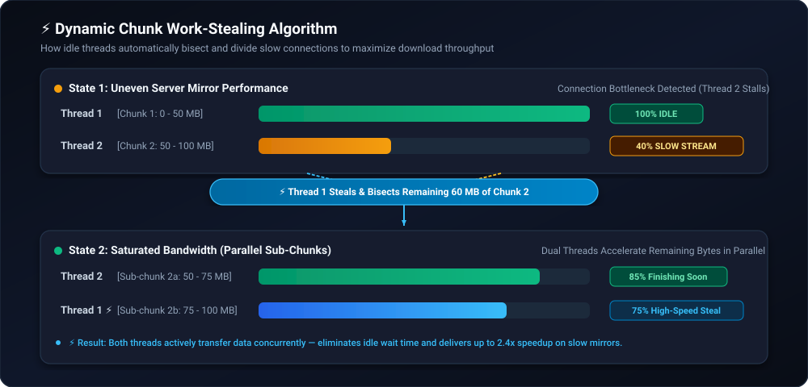
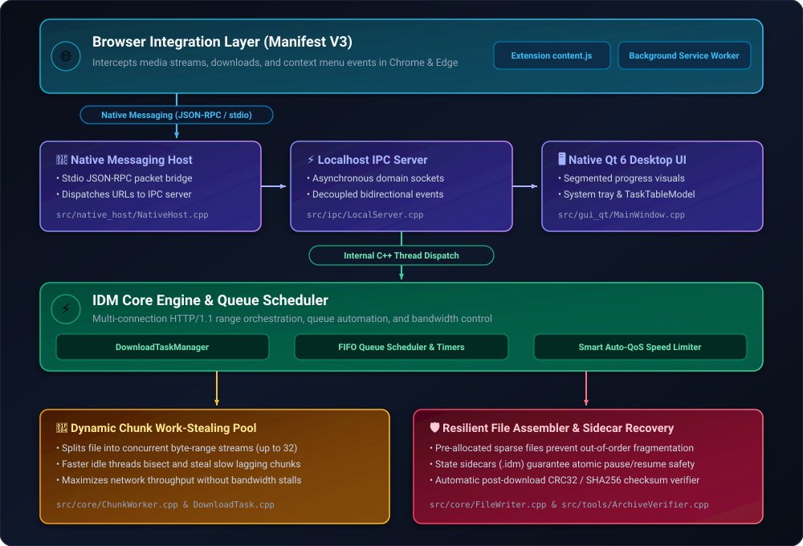

# Internet Download Manager (IDM) — Native C++ Accelerator

<div align="center">


[](https://github.com/Someshwar-Sahu/idm/actions/workflows/build_all_platforms.yml)
[](https://isocpp.org/)
[](https://www.qt.io/)
[](#-pre-built-installers)

**A high-performance, multithreaded download accelerator developed in modern C++ with a pure native Qt 6 desktop interface.**  
*Engineered by the Student Engineering Team as an Academic Computer Science & Systems Programming Capstone Project.*

[Installers](#-pre-built-installers) • [Browser Extension Setup](#-browser-extension-setup) • [Features](#-key-features) • [Engine Architecture](#-engine-architecture) • [Building From Source](#-building-from-source) • [Project Notice](#-project-information--academic-disclaimer)

</div>

---

## 🎓 Academic Notice & Project Scope

> **Important Academic Disclaimer:**  
> This project is an **independent academic implementation** created solely for educational, research, and portfolio purposes for a college engineering degree.  
> - **Clean-Room Engineering:** All backend network routines, socket IPC, dynamic work-stealing algorithms, and Qt desktop interfaces were written from scratch. Zero proprietary or decompiled code is used.  
> - **Trademark Notice:** This project is **not affiliated with, endorsed by, or associated with Tonec Inc.** or the commercial software "Internet Download Manager". All visual styling and workflow patterns are implemented as an academic study in network protocol acceleration and desktop systems engineering.

---

## 📦 Pre-Built Installers

Native release packages are compiled across all three operating systems via GitHub Actions CI/CD:

| Operating System | Package | Architecture | Features | Download |
| :--- | :---: | :---: | :--- | :---: |
| 🪟 **Windows** | **`.exe`** | 64-bit (`x86_64`) | Standalone Inno Setup Wizard, Desktop & Start Menu shortcuts, native browser host registration, zero terminal popups. | [**Download .exe**](../../releases/latest/download/IDMan_Setup_v6.42.exe) |
| 🍏 **macOS** | **`.dmg (zip)`** | Apple Silicon & Intel | Native Apple Disk Image (`IDMan_macOS_v6.42.dmg`) with drag-and-drop `IDMan.app` bundle and macOS menu integration. | [**Download .dmg**](../../releases/latest/download/IDMan_macOS_v6.42.zip) |
| 🐧 **Linux** | **`.deb / .tar.gz`** | Universal Linux | Complete package bundle containing native Debian package (`.deb`) and portable archive (`.tar.gz`). | [**Download Linux**](../../releases/latest/download/IDMan_Linux_Packages.zip) |

> 💡 **Direct Downloads:** Pre-built release binaries are published under [**Releases**](../../releases/latest). Click any link above to start downloading immediately.

---

## 🧩 Browser Extension Setup

Because this is an independent academic project and not published on the commercial Google Chrome Web Store, the browser extension is loaded locally via **Developer Mode**:

```
idm/
└── extension/
    ├── manifest.json                  # Manifest V3 extension configuration
    ├── background.js                  # Background service worker & native bridge
    ├── content.js                     # Media stream & download link interceptor
    ├── com.idm.native_host.json       # Native Messaging Host manifest
    └── install_native_host.ps1        # Windows registry registration script
```

### Step 1: Load the Extension in Your Browser
1. Open **Google Chrome** or **Microsoft Edge**.
2. Navigate to your browser's extensions page:
   - Chrome: `chrome://extensions`
   - Edge: `edge://extensions`
3. Toggle on **Developer mode** (switch located in the top-right corner).
4. Click the **Load unpacked** button.
5. In the file picker, select the [`extension/`](extension/) directory from this repository.
6. The **IDM Download Integration** extension will appear with a 32-character Extension ID (e.g., `bjgkbgeokfiebnpmenpcojhlehlapjih`).

---

### Step 2: Register the Native Messaging Host

The Native Messaging Host is a lightweight C++ bridge that allows the browser extension to communicate directly with the local IDM desktop app via standard I/O (stdin/stdout).

#### On Windows:
1. Open **PowerShell as Administrator** in the project directory.
2. Run the registration script:
   ```powershell
   .\extension\install_native_host.ps1
   ```
   *(Note: If you install IDM using the pre-built `IDMan_Setup_v6.42.exe`, this registration happens automatically during setup).*

#### On Linux / macOS:
Copy the [`com.idm.native_host.json`](extension/com.idm.native_host.json) manifest to your browser's native messaging directory:
- **Linux (Chrome)**: `~/.config/google-chrome/NativeMessagingHosts/`
- **Linux (Chromium)**: `~/.config/chromium/NativeMessagingHosts/`
- **macOS (Chrome)**: `~/Library/Application Support/Google/Chrome/NativeMessagingHosts/`

Ensure the `"path"` in `com.idm.native_host.json` points to the compiled `IDMan` executable on your system.

---

## ⚡ Key Features

- **🚀 Dynamic Work-Stealing Chunking:**
  Files are divided into concurrent byte-range streams (configurable up to 32 connections). Faster worker threads that finish early dynamically bisect and assist slower connections, eliminating lagging tails and saturating available network bandwidth.

  <p align="center">
    
  </p>

- **🛡️ State Recovery & Resilient Resume:**
  Non-destructive sidecar metadata (`.idm`) persists chunk boundaries, downloaded byte offsets, and ETags. Downloads can be paused and resumed cleanly across network drops or system reboots.

- **🗂️ Automatic Category Partitioning:**
  Incoming downloads are automatically classified and organized into dedicated system folders:
  - 📄 **Documents** (`.pdf`, `.docx`, `.xlsx`, `.txt`, `.pptx`)
  - 📦 **Compressed** (`.zip`, `.rar`, `.7z`, `.tar`, `.gz`, `.iso`)
  - 🎬 **Video** (`.mp4`, `.mkv`, `.avi`, `.mov`, `.webm`)
  - 🎵 **Music** (`.mp3`, `.flac`, `.wav`, `.aac`)
  - 💻 **Programs** (`.exe`, `.msi`, `.dmg`, `.deb`, `.pkg`)
  - 📁 **General** (all other formats)

- **⏱️ Scheduler & Queue Automation:**
  FIFO download queueing with configurable concurrent task limits, scheduled start/stop execution times, and automated post-queue actions (*Turn off computer*, *Sleep*, *Exit IDM*).

- **🧠 Smart Auto-QoS & Bandwidth Limiter:**
  Dynamic latency-aware bandwidth throttling modes:
  - *Maximum Speed* (Uncapped multi-connection saturation)
  - *Smart Auto-QoS* (Automatically throttles when local gaming/streaming latency spikes)
  - *Manual Cap* (User-defined speed limits)

- **🔐 Encrypted Site Logins Vault:**
  Secure credential storage for password-protected download sources (HTTP Basic, Digest, Bearer).

---

## 🏛 Engine Architecture

The application is structured into a modular, multi-tier architecture with clean separation between the user interface, network worker pool, and browser bridge:

<p align="center">
  
</p>

### 🔄 End-to-End Download Pipeline

1. **Capture**: Browser Extension intercepts media streams or download URLs via context menus and download listeners.
2. **IPC Bridge**: The extension dispatches a JSON-RPC payload over standard I/O to the C++ Native Messaging Host, which forwards it to the local IDM IPC Server.
3. **Task Initialization**: `DownloadTaskManager` probes the remote URL (detecting HTTP Range support, file size, MIME type, and redirect URLs).
4. **Dynamic Chunking**: The file is segmented into parallel byte ranges, distributed across active worker threads in the pool.
5. **Work-Stealing**: Faster threads monitor slower connections; if a chunk stalls, an idle thread automatically bisects the slowest segment and takes over the remaining range.
6. **Sparse Assembly & Verification**: Data chunks are committed to pre-allocated sparse storage alongside `.idm` state sidecars, followed by CRC32 / SHA256 integrity checks.

---

### 🧩 Subsystem Architecture

| Subsystem | Source Location | Engineering Responsibility |
| :--- | :--- | :--- |
| **⚡ Acceleration Core** | [`src/core/`](src/core/) | Multithreaded chunk worker pool with real-time dynamic work-stealing, slow-chunk bisection, and sparse disk I/O. |
| **🖥️ Native Qt 6 GUI** | [`src/gui_qt/`](src/gui_qt/) | Pure C++ desktop interface with custom segmented chunk progress widget, system tray integration, and modal dialogs. |
| **🌐 Browser Bridge** | [`src/native_host/`](src/native_host/) | Manifest V3 Native Messaging Host bridging browser events to the desktop application over stdin/stdout. |
| **🔌 IPC Server** | [`src/ipc/`](src/ipc/) | Local asynchronous REST API server (`127.0.0.1:8080`) handling JSON-RPC commands and event dispatching. |
| **🎬 Media Processing** | [`src/media/`](src/media/) | Stream link extraction (YouTube, Vimeo, MP4, HLS) and live HTTP streaming previewer for partial downloads. |
| **📡 Networking & QoS** | [`src/net/`](src/net/) | Multi-adapter channel bonding, real-time ping/latency monitoring, Smart Auto-QoS throttling, and power state awareness. |
| **⏱️ Queue Scheduler** | [`src/queue/`](src/queue/) | FIFO queue manager with concurrency limits, calendar scheduling, and OS-native action center notifications. |
| **🛡️ Security & Vault** | [`src/security/`](src/security/) | Defender CLI / AMSI malware scanning, ZoneId=3 MOTW tagging, quarantine isolation, and AES-256 encrypted credential vault. |
| **⚙️ Config Management** | [`src/config/`](src/config/) | User settings persistence (`settings.json`), automatic category file type mapping, and path routing. |
| **🔍 Tools & Verification** | [`src/tools/`](src/tools/) | Pre-extraction CRC32 and header integrity verification for ZIP/RAR/7z archives. |

---

## 💻 Building From Source

### Prerequisites
- **CMake** (>= 3.20)
- **Ninja** or **Make**
- **Qt 6.7+** (`Core`, `Gui`, `Widgets`, `Network`, `Svg`)
- **C++20 compliant compiler** (MinGW GCC 13+, Clang 15+, or Apple Clang)
- **libcurl** (automatically fetched if not present on system)

### 1. Windows (MinGW 64-bit)
```powershell
# Configure CMake
cmake -B build -G "Ninja" -DCMAKE_BUILD_TYPE=Release -DCMAKE_PREFIX_PATH="C:\Qt\6.7.2\mingw_64"

# Compile IDMan
cmake --build build --target idm_app --config Release

# Package dependencies and Qt DLLs
.\package.ps1

# (Optional) Compile standalone installer via Inno Setup
& "D:\Inno Setup 6\ISCC.exe" installer.iss
```

### 2. Linux (Ubuntu / Debian)
```bash
# Install dependencies
sudo apt-get update && sudo apt-get install -y \
  build-essential cmake ninja-build qt6-base-dev qt6-base-dev-tools \
  libqt6svg6-dev libgl1-mesa-dev libegl1-mesa-dev libxkbcommon-dev libcurl4-openssl-dev

# Build & Package .deb
./package_linux.sh
```

### 3. macOS (Apple Silicon & Intel)
```bash
# Install Qt 6 and Ninja
brew install qt@6 ninja

# Build & Package .dmg
./package_mac.sh
```

---

## 📂 Repository Structure

```
idm/
├── .github/
│   └── workflows/
│       └── build_all_platforms.yml # CI/CD for Windows, macOS, and Linux
├── docs/                           # Technical documentation, diagrams, and flowcharts
│   ├── design_specification.md     # Full engineering architecture specification
│   ├── architecture.svg            # Multi-tier system architecture diagram
│   └── work_stealing.svg           # Dynamic chunk work-stealing flowchart
├── src/
│   ├── config/                     # SettingsManager & settings.json persistence
│   ├── core/                       # DownloadTask, ChunkManager, ChunkWorker, FileWriter, ResumeStore
│   ├── gui_qt/                     # Pure Qt 6 Native GUI Views, Models, and Dialogs
│   ├── ipc/                        # Asynchronous Local REST API Server (port 8080)
│   ├── media/                      # Media stream extractor & live media preview proxy
│   ├── native_host/                # Chrome/Edge Native Messaging Host binary
│   ├── net/                        # Channel bonding, latency monitor, Smart QoS, power monitor
│   ├── queue/                      # DownloadQueue scheduler & native action center notifications
│   ├── security/                   # Defender/AMSI antivirus scanner & AES-256 encrypted vault
│   └── tools/                      # ArchiveVerifier (ZIP/RAR/7z integrity validation)
├── test/                           # 22 automated unit test suites (100% PASS)
├── extension/                      # Chrome / Edge Manifest V3 Browser Extension
├── installer.iss                   # Inno Setup Windows installer script
├── package.ps1                     # Windows packaging script
├── package_linux.sh                # Linux CPack .deb packaging script
├── package_mac.sh                  # macOS macdeployqt .dmg packaging script
├── CMakeLists.txt                  # Universal CMake build definitions
└── README.md                       # Main project documentation
```

---

## 🎓 Project Information & Academic Disclaimer

This software is developed strictly for **academic, research, and educational demonstration** as a university computer science team capstone project.

- **Clean-Room Implementation**: Developed from first principles using standard networking protocols and open-source libraries (Qt 6, libcurl, nlohmann/json).
- **Non-Commercial**: This is an educational student submission and is not intended for commercial distribution or sale.
- **Trademark Notice**: All product names, logos, and brands are property of their respective owners. Mention of them is solely for comparative study and academic evaluation.
